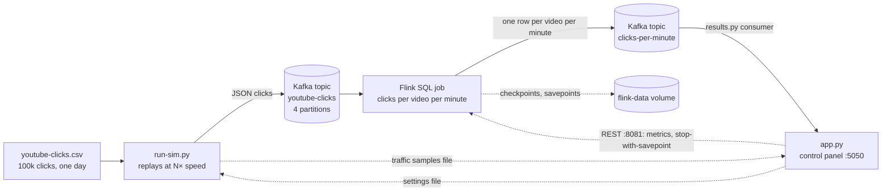

# Architecture

## Data flow

Everything runs on one laptop.  Kafka and Flink are in Docker (`docker-compose.yml`); the simulator and the control panel run on the host.

| Service | Port | Purpose |
| --- | --- | --- |
| Control panel | 5050 | Controls, traffic chart, Flink job summary, top videos |
| Flink jobmanager | 8081 | Flink web UI and REST API |
| Redpanda (Kafka API) | 19092 from the host, `kafka:9092` inside Docker | Clicks in, results out |
| Redpanda Console | 8080 | Browse topics and messages |

## The simulator (`run-sim.py`)

It reads the CSV in timestamp order and produces each click to Kafka when the simulated clock reaches it.  `SimulationClock` turns wall time into simulated time at the current speed.

The panel controls it through `.simulation-control.json`, which the simulator re-reads at most every 200ms.  That avoids an IPC channel between two processes.  The file holds:

| Setting | Effect |
| --- | --- |
| `paused`, `speed` | Drive the simulation clock |
| `burst_until`, `burst_factor` | Until that epoch time, send every click `burst_factor` (10) times |
| `late_percent` | Hold back that share of clicks for 5 simulated minutes.  They keep their original timestamp. |

Late clicks wait in a heap ordered by send time.  Before each new click, any held-back click that is due is sent first, so everything still goes out in simulated-time order.

Once a second the simulator appends a 24-byte sample (expected, attempted, acknowledged, and failed sends) to `.traffic-metrics.bin`.  The format lives in `traffic_metrics.py` and `static/traffic-metrics.mjs`, and a shared test fixture keeps the two in agreement.  A fixed-size record lets the panel read just the last 15 minutes by seeking to the end.

## The Flink job (`sql/clicks-per-minute.sql`)

It reads JSON from `youtube-clicks`, derives `click_time` from each click's own timestamp, counts clicks per video in one-minute tumbling windows, and writes one row per video per minute to `clicks-per-minute`.

 - **Event time, not arrival time.**  Windows follow the simulated clock, so the counts are the same at 1× or 10000×.
 - **Watermark: 10 seconds.**  A minute is emitted once a click 10 seconds past its end has been seen.  Clicks for that minute that arrive later are dropped and counted in `numLateRecordsDropped`.
 - **The watermark advances only every 200ms of wall time** (`pipeline.auto-watermark-interval`).  At high speeds that is many simulated seconds, so the watermark trails further behind and "late" clicks can still land in an open window.  Measured with 5-minute-late clicks: at 120× all were dropped, at 1000× about half.
 - **Idle partitions: 5 seconds.**  The watermark is the minimum across partitions, so one quiet partition would stall every window.  After 5s without data a partition is ignored.
 - **Checkpoints every 10 seconds.**  Each one saves the open windows' counts and makes the source commit its Kafka offsets.  A resubmitted job starts from the committed offsets (`scan.startup.mode = group-offsets`).
 - **At-least-once output.**  If the job restarts between writing a row and the next checkpoint, the row is written again.  Readers keep the latest count per (video, minute), so a repeat is harmless.  Exactly-once would need Kafka transactions, plus readers that only see committed rows.
 - **The last window never closes** when traffic stops, because nothing advances the watermark past it.  That's expected for an unbounded stream.

## The control panel API (`app.py`)

| Endpoint | What it does |
| --- | --- |
| `GET /api/status` | Panel state: running, paused, speed, parallelism, late %, seconds of spike left |
| `POST /api/start`, `/stop`, `/restart` | Start or stop Docker, the Flink job and the simulator |
| `POST /api/traffic {paused}` | Pause or resume the simulator |
| `POST /api/speed {speed}` | Simulated-time speed |
| `POST /api/parallelism {parallelism}` | Rescale the running job (see below) |
| `POST /api/late {late_percent}` | Share of clicks to send late |
| `POST /api/burst` | Start a 30 second ×10 spike |
| `GET /api/traffic` | The simulator's last 15 minutes of samples, binary |
| `GET /api/flink` | The latest Flink job snapshot plus 15 minutes of history |
| `GET /api/top-videos` | The 10 most clicked videos in the latest closed minute |

Settings endpoints accept only the listed values and answer 400 otherwise.  Every write goes to the settings file the simulator polls.

**Starting** runs in a background thread: `docker compose up`, wait for Flink's REST API, start the results consumer, submit the job, start the simulator.  This keeps `/api/status` responsive during the minute Docker can take.  A stop during start-up bumps a generation counter; the boot thread checks it before each step and gives up.  Stopping the panel (Ctrl+C or SIGTERM) runs `docker compose down`.  That hook is registered only when `app.py` is run directly, so tests can import it safely.

**Submitting** the job writes the per-run settings (`parallelism.default`, and a savepoint path when rescaling) to `sql/.session.sql`.  The panel then runs `sql-client.sh -i sql/.session.sql -f clicks-per-minute.sql`.  Because the job is an `INSERT`, the client exits once the job is running.

### How `/api/flink` computes its numbers (`flink_monitor.py`)

A background thread takes a snapshot once a second.  The endpoint just returns the latest one, so browsers polling it never hit Flink directly.  Each snapshot:

1. `GET /overview` for the number of TaskManagers and slots.
2. `GET /jobs/overview` and pick the newest RUNNING job.
3. `GET /jobs/{job}` for its vertices.  A vertex is a chain of operators that runs as one task, e.g. "Source → Calc" and "GroupWindowAggregate → Calc → Sink".
4. For each vertex, `GET /jobs/{job}/vertices/{vertex}/subtasks/metrics?get=…`.  Flink returns each metric aggregated over the vertex's parallel subtasks as `min`, `max`, `avg` and `sum`.

From those:

| Number | Metric | How |
| --- | --- | --- |
| parallelism | vertex `parallelism` | The source vertex's |
| records/s consumed | `numRecordsOut` on the source vertex, `sum` | A counter, so: (count now − count 5s ago) ÷ elapsed seconds.  Flink's own `numRecordsOutPerSecond` averages over 60s, too slow for a live chart.  Flink refreshes metrics about once a second (`metrics.fetcher.update-interval: 1000`; the default is 10s), the same rate we sample at.  Differencing over 5s rather than 1s keeps that from showing as alternating 0 and double readings. |
| lag | `<source>.pendingRecords`, `sum` | Records in Kafka the source hasn't read yet, summed over partitions |
| busiest task | `busyTimeMsPerSecond`, `max` over every vertex | ms per second a subtask spent processing, ÷ 10 = percent.  Near 100% means that operator is the bottleneck. |
| backpressure | `backPressuredTimeMsPerSecond`, `max` | Time a subtask spent waiting for the next one to accept its output.  The bottleneck is *downstream* of a backpressured task. |
| late dropped | `<window operator>.numLateRecordsDropped`, `sum` | Clicks that arrived after their minute had been emitted |

Three gotchas this handles, each found against a live cluster:

 - **Brackets in metric names.**  Operator metric names contain brackets (`GroupWindowAggregate[4].numLateRecordsDropped`), and Flink silently returns nothing for them unless they're URL-encoded.
 - **Late-registered metrics.**  Operators register their metrics as they start, so a vertex's metric names are re-listed every 10s rather than cached once.
 - **`"NaN"` strings.**  An idle task reports busy time as the string `"NaN"`; values are parsed with `float()`, and NaN is skipped.

The history is a ring buffer of `(time, records/s, lag)` for the last 900 samples.  The chart plots it on the same time axis as the simulator's samples, clipped to the current run.

### How rescaling works

`POST /api/parallelism` with a new value, while the job runs:

1. `POST /jobs/{job}/stop {"drain": false}` makes Flink take a **savepoint** and then stop the job.  A savepoint is a consistent snapshot of every operator's state: open windows' partial counts and the source's Kafka offsets.
2. Poll `GET /jobs/{job}/savepoints/{trigger}` until it reports the savepoint's location under `/flink-data/savepoints`.
3. Resubmit the job with `parallelism.default = N` and `execution.savepoint.path = <location>`.  On restore Flink redistributes the state by key group: keys are hashed into 128 key groups (the max parallelism), and each subtask takes a contiguous range of them.

No click is lost or counted twice, and the open windows carry on.  The savepoint directory is a Docker volume shared by the jobmanager and the TaskManagers: TaskManagers write their state, and the jobmanager writes the metadata that points to it.

### How the top videos are computed (`results.py`)

A Kafka consumer reads `clicks-per-minute` from the beginning, using a fresh group id each start so it never shares offsets.  Each row `{videoid, window_start, click_count}` is stored as `windows[window_start][videoid] = click_count`.

Rows are *set*, not added, so an at-least-once duplicate doesn't inflate a count.  Only the last 5 minutes are kept.  `/api/top-videos` takes the newest minute, sorts by count (then name, so ties are stable), and returns the top 10 plus the minute's total.

## Correctness, verified

`test_e2e.py` (`make e2e`) replays the day of clicks through the real stack and checks every (video, minute) count Flink writes against the CSV:

| Scenario | Rows written | Rewritten | Counts correct |
| --- | --- | --- | --- |
| Rescale 4 → 2 mid-run (stop-with-savepoint) | 46,890 | 0 | all 46,890 |
| TaskManager killed mid-run (restart from checkpoint) | 47,300 | 410 | all 46,890 |

A savepoint stop is clean, so nothing is rewritten.  After a crash, Flink rewinds to the last checkpoint and replays.  Rows written since that checkpoint are written again, and the reader's "latest count wins" makes that harmless.  This is what at-least-once output plus idempotent readers buys, without Kafka transactions.

## The control panel's own security

The panel only binds to 127.0.0.1, but a web page open in the same browser can still send it requests.  It rejects any POST whose `Origin` is another site; `/api/stop` takes no body, so a browser would otherwise send it cross-site without asking.  It also rejects any request whose `Host` isn't local, which defeats DNS rebinding.

## Tuning decisions

Measured with `bench/` (see the README for the numbers):

 - **Parallelism 4 = partition count.**  This gives 2.5× the throughput of parallelism 1.  Each Kafka partition is read by at most one source subtask, so parallelism above the partition count only helps the aggregation.  To scale further, add partitions and parallelism together.
 - **8 slots per TaskManager.**  Each slot gets an equal share of the TaskManager's memory.  The original 100 slots left each about 5MB of managed memory.
 - **Spread slots evenly** (`cluster.evenly-spread-out-slots`).  Without it Flink fills one TaskManager before using the next, so a second TaskManager sat idle.
 - **No mini-batch.**  It only affects unbounded `GROUP BY` aggregates, not window aggregates, and measured no difference.
 - **Legacy `GROUP BY TUMBLE(...)` over window TVFs.**  The TVF syntax was ~10% slower for this query.  TVFs are the recommended syntax going forward and support more window types, so revisit this if the query grows.

## Known limitations

 - **Late clicks at very high speeds.**  Above ~1000× the watermark trails by more than the 5-minute delay, so few late clicks are dropped.  Lowering `pipeline.auto-watermark-interval` would tighten it at some CPU cost.
 - **Kafka data is not persisted.**  `docker compose down` deletes it, which keeps runs reproducible.  Checkpoints and savepoints do persist in the `flink-data` volume; `docker compose down -v` removes them.
 - **One machine.**  More TaskManagers share the same CPUs, so scaling out here shows JVM and network effects, not added capacity.
